# Мобильный робот: езда по линии, лабиринт, сборка мусора

Учебный проект в рамках курса по робототехнике: спроектировать, собрать и запрограммировать мобильного робота, который решает три задачи:

1. **Езда по линии** — движение вдоль чёрной линии на светлом поле.
2. **Прохождение лабиринта** — поиск выхода из лабиринта со стенками.
3. **Сборка мусора** — обход огороженной территории и вывоз мусора к выходу ковшом, который робот тащит за собой.

Между задачами разрешено перепрошивать робота, поэтому прошивка собрана из независимых модулей, а нужный алгоритм выбирается в `src/main.cpp` раскомментированием одного `#define` (подробнее — в разделе [Выбор задачи при прошивке](#выбор-задачи-при-прошивке)).

<p align="center">
  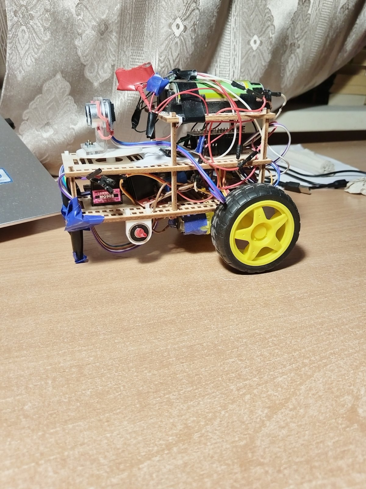
  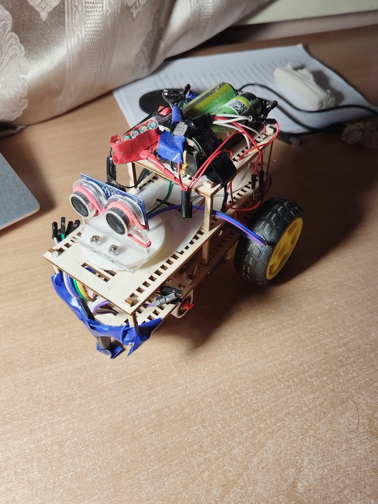
  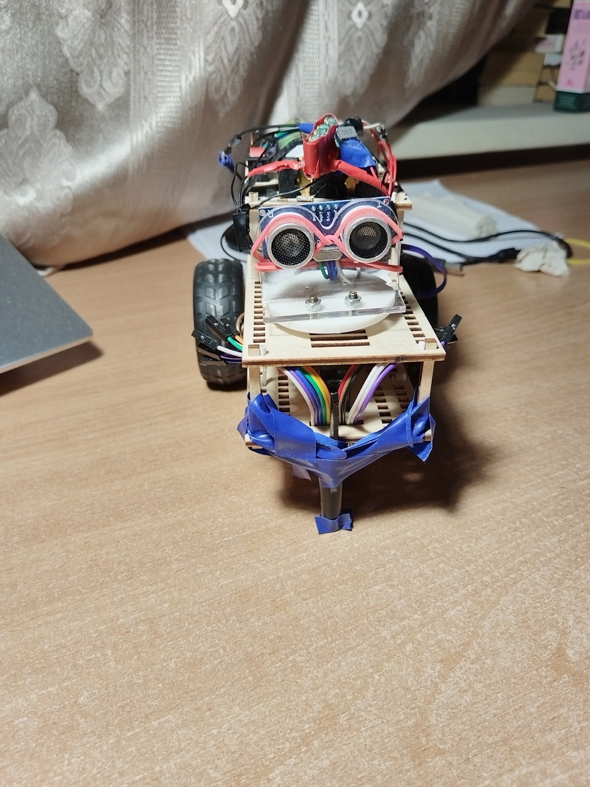
</p>
<p align="center"><i>Робот после всех испытаний</i></p>

---

## Содержание

- [Мобильный робот: езда по линии, лабиринт, сборка мусора](#мобильный-робот-езда-по-линии-лабиринт-сборка-мусора)
  - [Содержание](#содержание)
  - [Видео](#видео)
  - [Конструкция](#конструкция)
    - [CAD-модель](#cad-модель)
    - [Что пошло не по плану: вал переднего колеса](#что-пошло-не-по-плану-вал-переднего-колеса)
    - [Ковш для сборки мусора](#ковш-для-сборки-мусора)
  - [Электроника и подключение](#электроника-и-подключение)
    - [Принципиальная схема](#принципиальная-схема)
    - [Распиновка (`include/common.h`)](#распиновка-includecommonh)
  - [Структура прошивки](#структура-прошивки)
  - [Выбор задачи при прошивке](#выбор-задачи-при-прошивке)
  - [Базовые механизмы](#базовые-механизмы)
    - [Управление моторами и «импульсный» режим](#управление-моторами-и-импульсный-режим)
    - [Курс по гироскопу MPU6050](#курс-по-гироскопу-mpu6050)
    - [Удержание прямой](#удержание-прямой)
    - [Измерение расстояний сонаром на сервоприводе](#измерение-расстояний-сонаром-на-сервоприводе)
    - [Система действий (Action)](#система-действий-action)
  - [Задача 1. Езда по линии](#задача-1-езда-по-линии)
  - [Задача 2. Прохождение лабиринта](#задача-2-прохождение-лабиринта)
  - [Задача 3. Сборка мусора](#задача-3-сборка-мусора)
    - [Этап 1. Обход территории «змейкой»](#этап-1-обход-территории-змейкой)
    - [Этап 2. Выезд к выходу](#этап-2-выезд-к-выходу)
  - [Настраиваемые параметры](#настраиваемые-параметры)
  - [Сборка и прошивка](#сборка-и-прошивка)
  - [Известные особенности и уроки](#известные-особенности-и-уроки)

---

## Видео

Прохождение лабиринта:

- [Yandex Disk](https://disk.yandex.ru/d/LvmHDoeWMh3mHg)
- [Google Drive](https://drive.google.com/drive/folders/1dpOoLqJqn_IQrSWuXFFBmXWGmZMSPnMU?usp=sharing)

> Езду по линии и сборку мусора, к сожалению, заснять не догадался. При этом сборка мусора получилась очень удачной.

---

## Конструкция

### CAD-модель

Корпус спроектирован в Autodesk Inventor. Почти все детали корпуса **плоские** — это сделано специально, чтобы вырезать их из фанеры на лазерном станке. Лишь несколько не плоских деталей формы (поворотная площадка сонара, держатели для подшипников передних колёс, валы) напечатаны на 3D-принтере.

Робот состоит из трёх «этажей»:

| Уровень | Что расположено |
|---|---|
| Нижняя рама | Мотор-редукторы, драйвер двигателей, сервопривод, дуга с датчиками линии спереди |
| Средняя рама | Arduino Nano, поворотная площадка с ультразвуковым дальномером |
| Верхняя рама | Аккумуляторы |

<p align="center">
  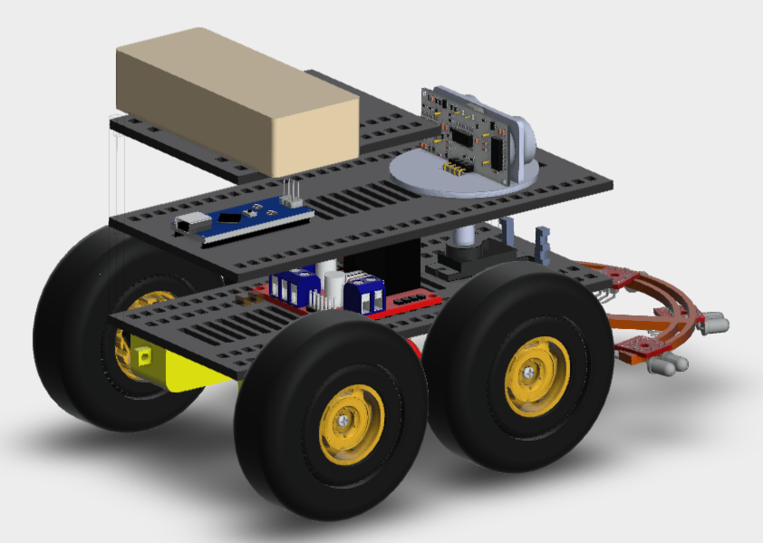
  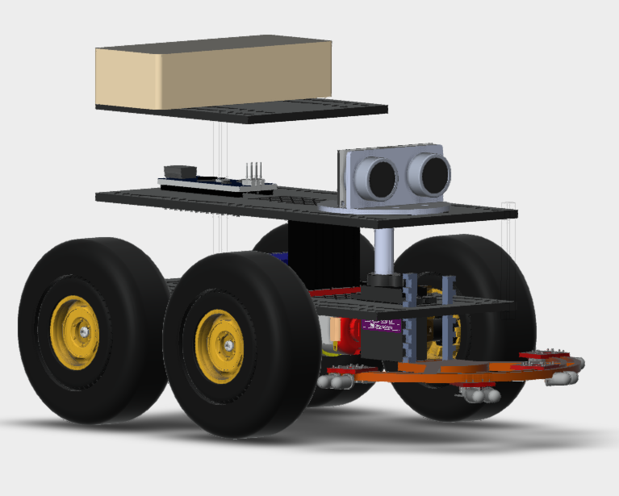
</p>
<p align="center"><i>CAD-модель робота (Inventor)</i></p>

Также были разработаны структурная, функциональная и электрическая принципиальная схемы робота.

> Чертежи не сохранились. Файл сборки Inventor остался, но открыть его сейчас нечем (доступны только Fusion 360 и FreeCAD).

### Что пошло не по плану: вал переднего колеса

К моменту прохождения лабиринта сломался **вал переднего колеса**, напечатанный на 3D-принтере.

Причина — неправильная ориентация детали при печати. Вал работает на **изгиб поперёк своей оси**, а напечатан был **осью вверх**. При такой ориентации слои пластика ложатся поперёк оси вала, и изгибающая нагрузка приходится как раз на межслойные соединения — самое слабое место FDM-печати. Прочность на изгиб получается в разы ниже, чем у вала, напечатанного «лёжа» (когда слои идут вдоль оси).

```
Напечатан осью вверх (как было)           Напечатан лежа (как надо)               
       F ↓                                      F ↓                              
  ┌──────────────┐                         ┌──────────────┐                       
  │ ║ ║ ║ ║ ║ ║ ║│   слои поперёк оси      │══════════════│   слои вдоль оси      
--│ ║ ║ ║ ║ ║ ║ ║│-- изгиб «раскрывает»  --│══════════════│-- изгиб нагружает     
  │ ║ ║ ║ ║ ║ ║ ║│   межслойные швы        │══════════════│   сами нити пластика  
  └──────────────┘                         └──────────────┘                       

Ось обозначена штрихом "--"
```

Пришлось импровизировать: передние колёса заменили **колпачком от ручки**, примотанным изолентой к передней раме. Колпачок работает как опора скольжения, а робот фактически стал двухколёсным с задним приводом и передней опорой. Это хорошо видно на фотографиях выше.

### Ковш для сборки мусора

На этапе проектирования CAD задача сборки мусора не учитывалась, поэтому ковш пришлось делать уже по месту. Ковш установлен **сзади** робота и работает как веник: мусор не толкается перед роботом, а тащится за ним. Конструкция ковша:

- каркас **спаян из пластиковых счётных палочек**;
- рабочая кромка — **губка для мытья посуды**, которая плотно прилегает к полу и не пропускает мелкий мусор;
- к поверхности ковш прижимается за счёт **собственной геометрии** (рычаги-«ноги» шарнирно цепляются к раме) и **канцелярской резинки**, которая тянет его вниз. Благодаря этому ковш «плавает» и копирует неровности поля.

<p align="center">
  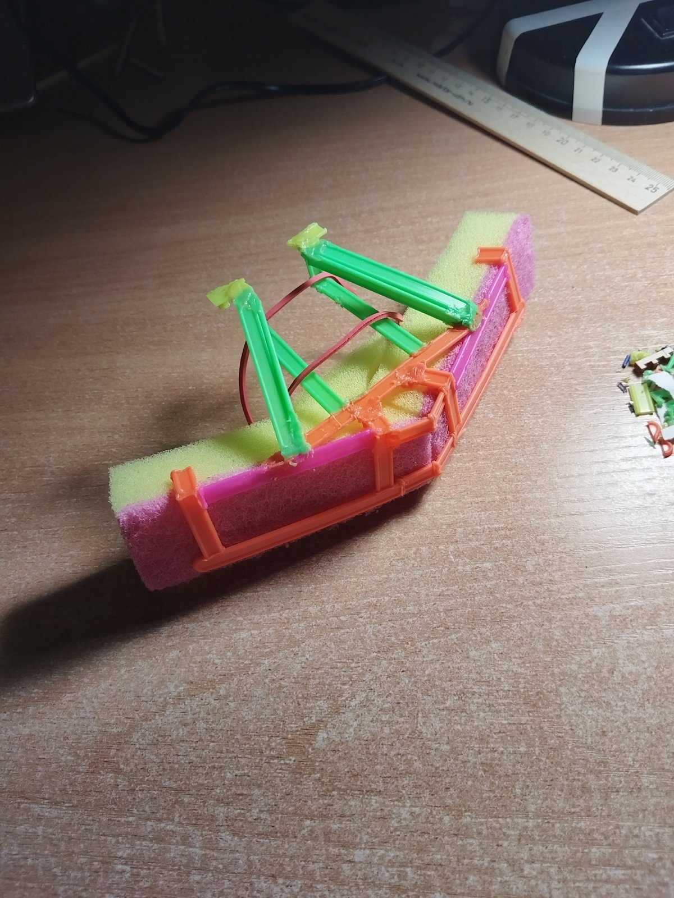
</p>

---

## Электроника и подключение

| Компонент | Назначение |
|---|---|
| Arduino Nano (ATmega328P) | Управляющий контроллер |
| 2 × мотор-редуктор с колёсами | Дифференциальный привод |
| Драйвер двигателей MX1508 (H-мост, 2 канала) | Управление моторами |
| Ультразвуковой дальномер HC-SR04 | Измерение расстояния до стен |
| Сервопривод MG90S | Поворот дальномера (влево / вперёд / вправо) |
| Гироскоп-акселерометр MPU6050 (I2C) | Определение курса (угла поворота вокруг вертикали) |
| 4 × ИК-датчика линии | Езда по линии |
| Литий-ионные аккумуляторы (7,2 В) + конденсатор 500 мкФ | Питание |
| Понижающий преобразователь DC-DC Mini 360 | 7,2 В → 5 В для сонара, гироскопа, сервопривода и датчиков линии |

### Принципиальная схема

<p align="center">
  <a href="images/electrical_scheme.pdf">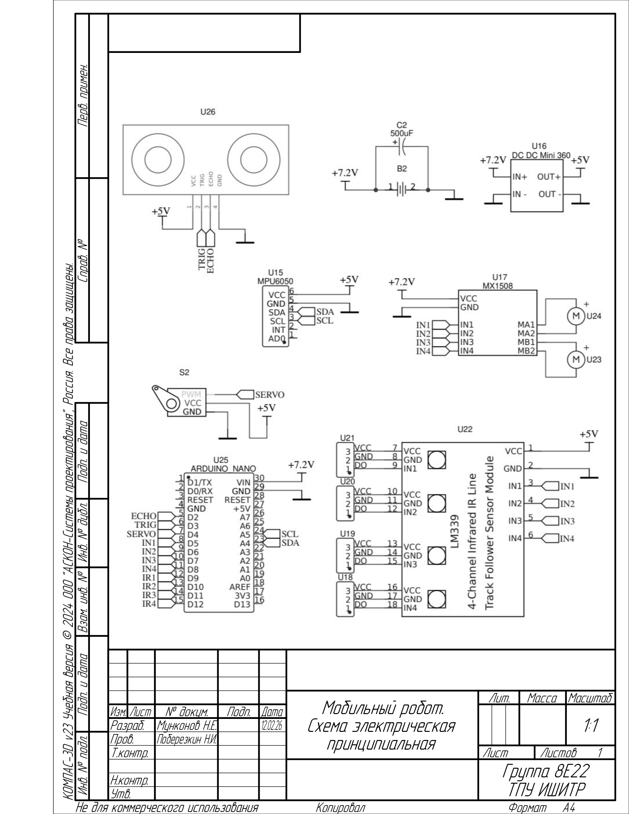</a>
</p>
<p align="center"><i>Схема электрическая принципиальная (<a href="images/electrical_scheme.pdf">PDF</a>)</i></p>

Питание: аккумулятор 7,2 В (с конденсатором 500 мкФ) напрямую питает Arduino Nano (`VIN`) и драйвер моторов MX1508. Преобразователь DC-DC Mini 360 понижает напряжение до 5 В для сонара HC-SR04, гироскопа MPU6050, сервопривода и модуля датчиков линии (LM339). Все «земли» общие.

> На схеме подписи сигналов у некоторых выводов Arduino перепутаны. Достоверной считается таблица распиновки ниже, она соответствует коду, проверенному на роботе: `TRIG` — D2, `ECHO` — D3; левый мотор — D5 (ШИМ) и D7, правый — D6 (ШИМ) и D8.

### Распиновка (`include/common.h`)

| Сигнал | Пин Arduino | Примечание |
|---|---|---|
| `TRIG_PIN` | D2 | HC-SR04 Trig |
| `ECHO_PIN` | D3 | HC-SR04 Echo |
| `SERVO_PIN` | D4 | Сервопривод сонара |
| `L_MOTOR_IN1` | D5 | Левый мотор, ШИМ |
| `L_MOTOR_IN2` | D7 | Левый мотор, направление |
| `R_MOTOR_IN1` | D6 | Правый мотор, ШИМ |
| `R_MOTOR_IN2` | D8 | Правый мотор, направление |
| `S_RIGHT_MOST` | D9 | Крайний правый датчик линии |
| `S_RIGHT` | D10 | Правый датчик линии |
| `S_LEFT` | D11 | Левый датчик линии |
| `S_LEFT_MOST` | D12 | Крайний левый датчик линии |
| MPU6050 SDA / SCL | A4 / A5 | Аппаратный I2C |

---

## Структура прошивки

Проект собирается в PlatformIO (`platformio.ini`, плата `nanoatmega328`, фреймворк Arduino).

```
├── src/
│   └── main.cpp                  # точка входа, выбор задачи
├── include/
│   ├── common.h                  # пины, константы, моторы, гироскоп, сонар
│   ├── action.h                  # система действий (конечные автоматы) и базовые манёвры
│   ├── line_following.h          # задача 1: езда по линии
│   ├── maze_solving.h            # задача 2: лабиринт (правило левой руки)
│   └── garbage_collection.h      # задача 3: сборка мусора
├── lib/                          # I2Cdev, MPU6050 (с DMP), Servo
└── images/                       # фото и рендеры для README
```

Зависимость `ericksimoes/Ultrasonic` подтягивается PlatformIO автоматически.

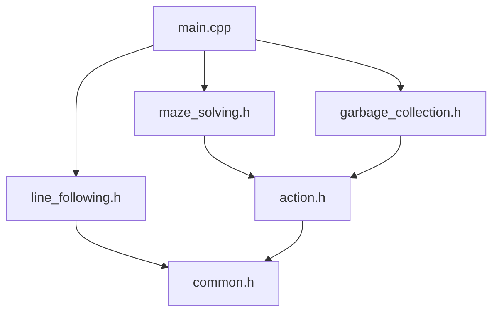

---

## Выбор задачи при прошивке

В `src/main.cpp` режим выбирается одним `#define MODE_*` — должен быть раскомментирован ровно один. Включается только соответствующий заголовок и вызывается только своя функция в `loop()`. Перед каждой задачей робот перепрошивается.

```cpp
// #define MODE_LINE_FOLLOWING
#define MODE_MAZE_SOLVING
// #define MODE_GARBAGE_COLLECTION

void setup() {
  Serial.begin(9600);
  setupGyroscope();   // инициализация MPU6050 + 5 с на стабилизацию
  setupMotors();
  setupServo();       // сонар смотрит вперёд (90°)
#ifdef MODE_LINE_FOLLOWING
  setupLineSensors();
#endif
}

void loop() {
#if defined(MODE_LINE_FOLLOWING)
  lineFollowing();       // задача 1
#elif defined(MODE_MAZE_SOLVING)
  mazeSolving();         // задача 2
#elif defined(MODE_GARBAGE_COLLECTION)
  garbageCollection();   // задача 3
#endif
}
```

| Задача | Макрос | Заголовок | Функция в `loop()` |
|---|---|---|---|
| Езда по линии | `MODE_LINE_FOLLOWING` | `line_following.h` | `lineFollowing()` |
| Лабиринт | `MODE_MAZE_SOLVING` | `maze_solving.h` | `mazeSolving()` |
| Сборка мусора | `MODE_GARBAGE_COLLECTION` | `garbage_collection.h` | `garbageCollection()` |

> Заголовки задач независимы друг от друга: общие манёвры (`turnLeft`, `moveStraight3cm` и т. д.) лежат в `action.h`. Всё собирается в одну единицу трансляции, поэтому в прошивку попадает только выбранный режим.

---

## Базовые механизмы

### Управление моторами и «импульсный» режим

Каждый мотор управляется парой пинов: `IN1` — ШИМ, `IN2` — направление.

```cpp
void setLeftMotor(int speed) {
  if (speed >= 0) { analogWrite(L_MOTOR_IN1, speed); digitalWrite(L_MOTOR_IN2, LOW);  }
  else            { analogWrite(L_MOTOR_IN1, speed); digitalWrite(L_MOTOR_IN2, HIGH); }
}
```

Для обратного хода в `analogWrite` передаётся отрицательное число. На AVR оно усекается до байта (`-150 → 106`), а при `IN2 = HIGH` мотор «видит» инвертированную скважность `255 − 106 ≈ 150`. Так что модуль скорости сохраняется и в обратную сторону.

Скорости задаются в два шага: `setMotorSpeeds(left, right)` только запоминает значения, а применяются они через `applyMotorSpeeds()` или `applyPeriodicSpeeds(period)`.

**Импульсный режим** `applyPeriodicSpeeds(75)` попеременно включает моторы на 75 мс и выключает на 75 мс. Причина — **мёртвая зона** колёс: при значении ШИМ от 0 до примерно 100 колесо вообще не вращается, а сразу после этого порога начинает вращаться быстрее, чем нужно. Скорее всего, это связано с невысоким качеством мотор-редукторов. Поэтому плавно снизить скорость нельзя: вместо этого моторы включаются на рабочем ШИМ короткими импульсами. Они дают достаточный момент для старта, но снижают среднюю скорость. Особенно это важно при поворотах на месте и точном подъезде к стенке.

### Курс по гироскопу MPU6050

Угол курса берётся из встроенного процессора движения (DMP) MPU6050 в виде кватерниона, который переводится в углы yaw/pitch/roll (`getAngleZ()`).

Yaw от DMP лежит в диапазоне `(−π; π]` и при переходе через ±π скачет на 2π. Чтобы угол был **непрерывным** (можно сделать несколько оборотов и не сломать регулятор), в коде ведётся счётчик оборотов `k`:

```cpp
float diff = angles[0] - prevAngle;
if (abs(diff) >= PI) k += (diff > 0) ? -1 : +1;   // произошёл переход через ±π
return angles[0] + 2*PI*k;
```

Дрейф по оси Z компенсируется смещением `Z_GYRO_OFFSET`, а после инициализации робот ждёт 5 секунд, пока показания DMP стабилизируются.

**Абсолютный курс.** Переменная `initAngle` хранит *заданное* направление движения. Каждый поворот на 90° меняет его ровно на `±π/2`, а не «на сколько повернули по факту». Поэтому ошибки отдельных поворотов не накапливаются: робот всегда стремится ехать строго вдоль осей лабиринта.

### Удержание прямой

`adjustSpeedsToMoveForward(base)` / `adjustSpeedsToMoveBackward(base)` — пропорциональный регулятор курса. Ошибка — это разница между заданным и текущим углом:

```
diffAngle = initAngle − currAngle
diffTerm  = diffAngle / π · TURN_STRENGTH        (TURN_STRENGTH = 1600)
```

Регулятор не ускоряет, а только **притормаживает одно из колёс** — то, в сторону которого нужно довернуть. Второе колесо всегда идёт на базовой скорости. Так робот не выходит за пределы допустимого ШИМ и не разгоняется при коррекции.

### Измерение расстояний сонаром на сервоприводе

Ультразвуковой дальномер стоит на сервоприводе и может смотреть в три стороны: `LEFT = 180°`, `FRONT = 90°`, `RIGHT = 0°`.

- `distanceOn(angle)` — повернуть сервопривод, подождать пропорционально углу поворота (`2 мс/градус`) и сделать одно измерение.
- `preciseDistanceOn(angle)` — то же самое, но ждёт не меньше `SONAR_DELAY_MS = 100 мс` (чтобы затихло эхо от предыдущего импульса) и **повторяет измерение, пока не получит ненулевое значение**. Нулевой результат у HC-SR04 означает сбой измерения.

**Ограничения сонара в лабиринте.** Показания сонара нестабильны на сложной геометрии: если он смотрит вперёд, в один момент расстояние может быть большим, а в следующий — совсем другим, потому что звук переотразился от небольшого угла бокового коридора. Если управлять движением по таким показаниям, робот ведёт себя непредсказуемо. Поэтому:

- в **лабиринте** движение выполняется **по таймеру** (`LinearMoveByTimer`), а сонар используется только для принятия решений (есть ли проём, близко ли стена);
- при **сборке мусора** в прямоугольной коробке с одним выходом геометрия простая, и движение выполняется **по расстоянию от сонара** (`LinearMoveToDistance`).

### Система действий (Action)

Чтобы сложные манёвры не превращались в «лапшу» из `delay()` и флагов, в `action.h` реализован небольшой фреймворк действий. Каждое действие — это **конечный автомат** со следующими состояниями:

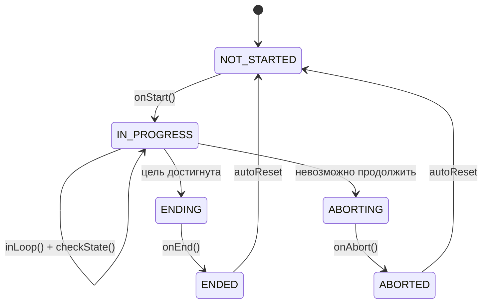

Наследник переопределяет нужные хуки (`onStart`, `inLoop`, `checkState`, `onEnd`, `onAbort`), а метод `perform()` выполняет **один шаг** автомата за вызов. Это позволяет:

- выполнять действие неблокирующе — по шагу на каждую итерацию `loop()`;
- или блокирующе через `blockingPerform(&action)` — крутить автомат до `ENDED`/`ABORTED`;
- собирать последовательности через **`ComplexAction`** — массив шагов, выполняемых по очереди, опционально **зацикленный** (`isCyclic`). Если любой шаг завершился `ABORTED`, вся последовательность завершается. Это используется как условие выхода из цикла.

Готовые манёвры:

| Действие | Что делает | Условие завершения |
|---|---|---|
| `TurnInDirection(±π/2)` (`turnLeft`, `turnRight`) | Разворот на месте (колёса в разные стороны) в импульсном режиме | Ошибка угла < `ANGLE_TOLERANCE`, **подтверждённая** повторным замером после остановки на 50 мс (исключает «проскок» по инерции). После этого `initAngle += direction` |
| `LinearMoveByTimer(ms, forward)` | Езда прямо/назад с удержанием курса заданное время | По таймеру. Используется как «шаг» фиксированной длины: 150 мс ≈ 3 см, 250 мс ≈ 5 см, 300 мс ≈ 6 см |
| `LinearMoveToDistance(cm)` | Сдвиг на `cm` относительно стенки впереди (`>0` — вперёд, `<0` — назад) по показаниям сонара | `ENDED` при точности ±2 см; `ABORTED`, если цель ближе 4 см к стене, а до стены уже меньше 6 см |
| `MoveForwardTillWall` | Ехать вперёд с удержанием курса | Стена ближе 25 см |
| `CheckSpaceInDirection(dir)` | Проверить, есть ли место сбоку | `ABORTED`, если в направлении `dir` стена ближе 25 см, иначе `ENDED` |

---

## Задача 1. Езда по линии

Файл: `include/line_following.h`, функция `lineFollowing()`.

Спереди робота на дуге установлены 4 ИК-датчика линии:

```
   S_LEFT_MOST   S_LEFT   S_RIGHT   S_RIGHT_MOST
       s1          s2        s3          s4
```

Используется **релейный (bang-bang) регулятор с приоритетами**:

| Состояние датчиков | Действие |
|---|---|
| Линия под `s2` или `s3` (центр) | Ехать прямо (`BASE_SPEED` на оба колеса) |
| Линия только под `s4` (крайний правый) | Резкий поворот направо на месте |
| Линия только под `s1` (крайний левый) | Резкий поворот налево на месте |
| Линия не видна ни одним датчиком | Сохранить последнюю команду |

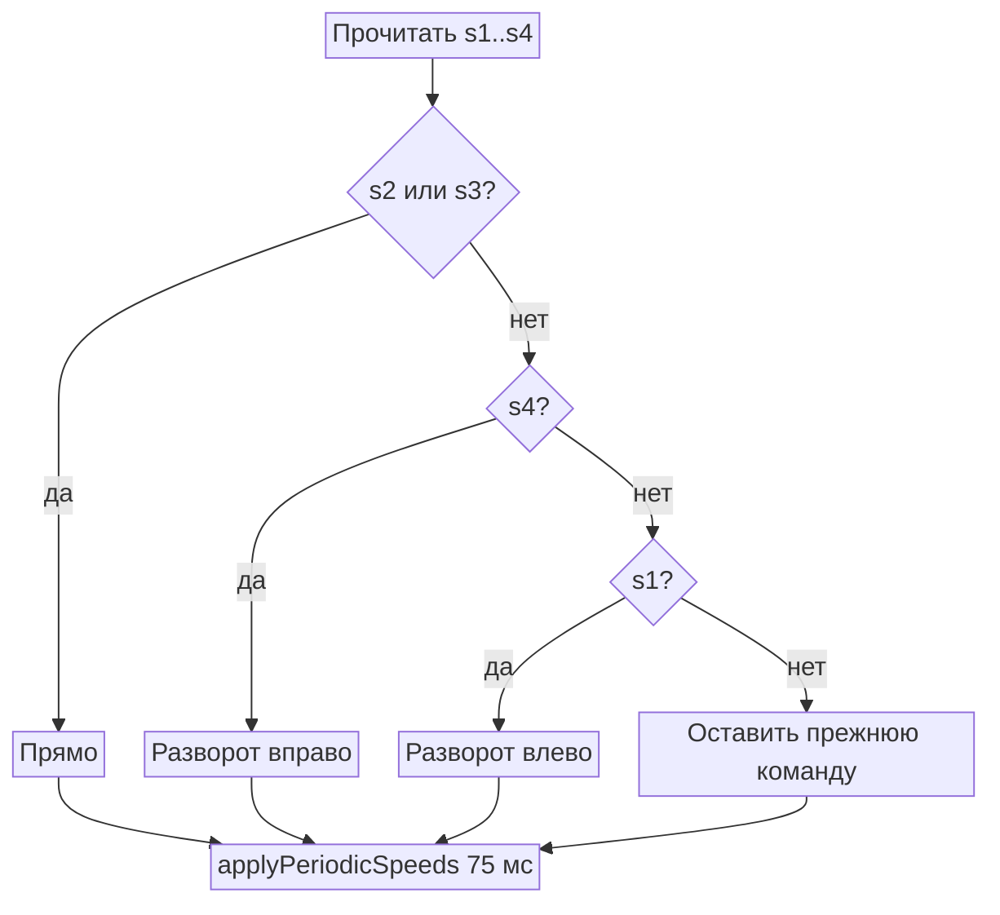

Ключевые идеи:

- **Память последней команды.** Если линия потеряна (например, на крутом повороте робот «проскочил»), скорости не сбрасываются, и робот продолжает поворачивать в ту сторону, где видел линию последний раз, пока не найдёт её снова.
- **Центральные датчики имеют приоритет**, поэтому на прямой робот не дёргается от срабатываний крайних датчиков.
- **Импульсный режим** (75 мс вкл / 75 мс выкл) снижает среднюю скорость, чтобы робот успевал реагировать на изменения линии.

> Линия считается обнаруженной при уровне `HIGH` на входе датчика.

---

## Задача 2. Прохождение лабиринта

Файл: `include/maze_solving.h`.

Функция `mazeSolving()` вызывает `mazeSolvingLeft()` — обход вдоль **левой** стены. Робот движется дискретными шагами по ~3 см (по таймеру, а не по сонару — см. [ограничения сонара](#измерение-расстояний-сонаром-на-сервоприводе)), и на каждом шаге измеряет расстояния слева и спереди.

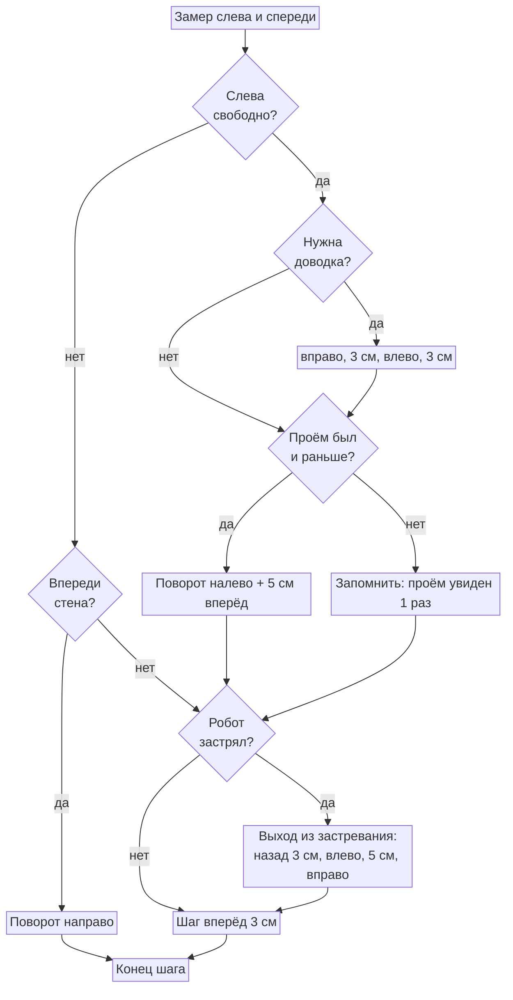

Условия на схеме: «слева свободно» — расстояние слева > 30 см; «нужна доводка» — предыдущим действием был поворот налево; «проём был и раньше» — проём слева виден уже второй шаг подряд; «впереди стена» — расстояние спереди < 10 см; «робот застрял» — расстояние спереди не меняется 3 шага подряд.

Приоритеты правила левой руки: **налево → прямо → направо**.

Доработки, которые понадобились на реальном поле:

1. **Подтверждение проёма слева.** Поворот налево выполняется, только если проём (> 30 см) виден **два шага подряд** (`freeLeft`). Это защищает от ложных срабатываний сонара (ультразвук может «проскочить» мимо угла стенки или переотразиться) и даёт роботу заехать в проём достаточно глубоко, чтобы не задеть угол при повороте.
2. **Доводка после поворота** (`needToMoveForward`). Если сразу после поворота налево слева снова пусто, робот, вероятно, стоит слишком близко к левому краю прохода. Тогда он делает «боковой шаг» — направо, 3 см, налево, 3 см — и смещается от стены.
3. **Детектор застревания** (`stuckCounter`). Если расстояние спереди не изменилось (±2 см) три шага подряд, значит робот упёрся углом в стену и буксует. Он отъезжает назад на 3 см и смещается влево манёвром «налево — 5 см — направо».
4. **Курс по гироскопу.** Все повороты — ровно на ±90° относительно абсолютного курса `initAngle`, а все проезды прямо — с удержанием курса. Без этого робот уже через несколько поворотов ехал бы по диагонали.

Также есть зеркальный вариант `mazeSolvingRight()` (правило правой руки, упрощённый, без подтверждения проёма и детектора застревания).

---

## Задача 3. Сборка мусора

Файл: `include/garbage_collection.h`, функция `garbageCollection()`.

Задача — пройти огороженную территорию так, чтобы закреплённый сзади ковш собрал весь мусор, и вывезти его к выходу. Алгоритм построен целиком на системе действий и состоит из двух этапов.

**Главная идея: ковш сзади работает как веник.** Когда робот едет вперёд, ковш тащит мусор за ним, и перед стеной за роботом накапливается кучка. Если просто развернуться, ковш размажет её, а при движении назад — оттолкнёт в сторону. Поэтому все манёвры построены так, чтобы кучка не терялась:

1. доехать до стены — мусор накоплен в ковше позади робота;
2. **немного отъехать назад** — ковш отходит от кучки, и она остаётся на месте;
3. **повернуть** к следующей полосе — кучка не задевается;
4. **немного проехать вперёд** — ковш чуть сдвигает кучку к следующей полосе;
5. снова **отъехать назад** и **повернуть** — робот оказывается направленным в обратную сторону на новой полосе;
6. ехать до следующей стены, подбирая мусор по пути.

Так собранный ранее мусор не теряется, и зигзаг по полю можно продолжать, постепенно перегоняя всё в одну сторону.

Этапы:

```cpp
Action *collectionSteps[2] = { &zigzagMovement, &moveToExit };
ComplexAction collectGarbage(collectionSteps, 2, false);
```

`garbageCollection()` вызывает `collectGarbage.perform()` — по одному шагу автомата за итерацию `loop()`.

### Этап 1. Обход территории «змейкой»

`zigzagMovement` — **зацикленная** последовательность из 14 действий, реализующая покрытие площади змейкой (бустрофедон):

```
   ┌─────────────────────────────┐
   │ ──────────────────────────► │  1. едем до стены
   │                           │ │  2. место слева есть? → сдвиг на полосу
   │ ◄────────────────────────── │  3. едем до стены
   │ │                           │  4. место справа есть? → сдвиг на полосу
   │ ──────────────────────────► │  ...
   │                           │ │
   │ ◄────────────────────────── │  места нет → змейка закончена
   └─────────────────────────────┘
```

| # | Действие | Смысл |
|---|---|---|
| 1 | `moveForwardTillWall` | Ехать вперёд до стены (< 25 см) |
| 2 | `checkSpaceOnLeft` | Слева стена ближе 25 см → **ABORTED**, обход закончен |
| 3 | `moveBackward7cm` | Отъехать назад: ковш отходит от кучки мусора, и она остаётся на месте |
| 4 | `turnLeft` | Повернуть к следующей полосе, не задевая кучку |
| 5 | `moveForward14cm` | Проехать вперёд на следующую полосу: ковш чуть сдвигает кучку мусора вперёд |
| 6 | `moveBackward7cm` | Снова отъехать назад, оставив кучку на месте |
| 7 | `turnLeft` | Развернуться в обратном направлении, после чего ехать к следующей стене |
| 8–14 | то же, но вправо | Обратный проход и смещение вправо |

Сдвиги «на полосу» выполняются действием `LinearMoveToDistance`, то есть **по сонару относительно стены впереди**, а не по времени. Поэтому шаг змейки не зависит от заряда аккумулятора и проскальзывания колёс.

Выход из цикла происходит естественно: когда после очередного прохода `CheckSpaceInDirection` обнаруживает, что сбоку уже стена, действие завершается `ABORTED`. `ComplexAction` воспринимает это как сигнал окончания и передаёт управление следующему этапу.

### Этап 2. Выезд к выходу

`moveToExit` — движение вдоль стены по правилу руки (тот же принцип, что в лабиринте). Сторона выбирается **автоматически по курсу**, на котором закончилась змейка:

- если робот развёрнут более чем на 90° от начального направления (`|currAngle| > π/2`) — правило **правой** руки;
- иначе — правило **левой** руки.

Так робот всегда идёт вдоль той стены, которая ведёт обратно к выходу, и при этом тащит за собой собранный ковшом мусор. Здесь используется тот же приём, что и в змейке: перед поворотом робот доезжает до точки поворота (`moveStraight11cm`) и отъезжает назад (`moveBackward7cm`), оставляя кучку на месте, и только потом поворачивает.

---

## Настраиваемые параметры

Все константы — в `include/common.h`.

| Константа | Значение | Назначение |
|---|---|---|
| `BASE_SPEED` | 150 | Скорость прямолинейного движения |
| `PERIODIC_SPEED` | 150 | Скорость в `LinearMoveToDistance` |
| `TURN_SPEED` | 130 | Скорость колёс при развороте на месте |
| `TURN_STRENGTH` | 1600 | Коэффициент П-регулятора курса |
| `Z_GYRO_OFFSET` | 9 | Калибровочное смещение гироскопа по Z (раньше было 18) |
| `ANGLE_TOLERANCE` | 0.15 рад | Допуск при повороте (≈ 8.6°) |
| `SERVO_DELAY_MS_PER_DEGREE` | 2 | Время поворота сервопривода на 1° |
| `SONAR_DELAY_MS` | 100 | Пауза между замерами сонара (затухание эха) |

Отладочный вывод в Serial (9600 бод) включается макросом `ROBOT_DEBUG` (макрос `PRINT` для целых, `printValue` для float).

---

## Сборка и прошивка

1. Установить [PlatformIO](https://platformio.org/) (например, как расширение VS Code).
2. Открыть папку проекта.
3. В `src/main.cpp` раскомментировать нужный `#define MODE_*`.
4. При необходимости поправить константы в `common.h` под задачу.
5. Собрать и загрузить: `pio run -t upload`.
6. После включения **не двигать робота 5 секунд** — гироскоп стабилизируется, начальный курс принимается за 0.

---

## Известные особенности и уроки

- **Ориентация печати важна.** Детали, работающие на изгиб (валы, оси, кронштейны), нужно печатать так, чтобы слои шли **вдоль** направления растягивающих напряжений. Ошибка с валом переднего колеса стоила передних колёс — их пришлось заменить колпачком от ручки.
- **Проектировать под все задачи сразу.** Ковш для мусора не был заложен в CAD, поэтому его пришлось собирать из подручных материалов. Хотя работать он в итоге стал очень хорошо.
- **Гироскоп + абсолютный курс** решают проблему накопления ошибки поворотов — без этого дифференциальный привод на дешёвых мотор-редукторах не едет прямо.
- **Сонар врёт.** В лабиринте звук переотражается от углов коридоров, и расстояние скачет. Поэтому там движение по таймеру, повторные замеры, пауза на затухание эха и подтверждение проёмов на двух шагах; движение по сонару оставлено только для простой коробки при сборке мусора.
- **Ошибка может быть не в коде, а в железе.** Потратил немалое количество времени на поиск причины ошибки в коде, когда ошибка была в железе. К примеру нет питания на модуле, провод не пропаялся, или подключение неправильное.
- `MoveToExit` не имеет условия остановки — робот продолжает идти вдоль стены, пока его не выключат.
